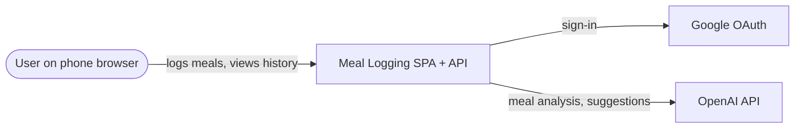
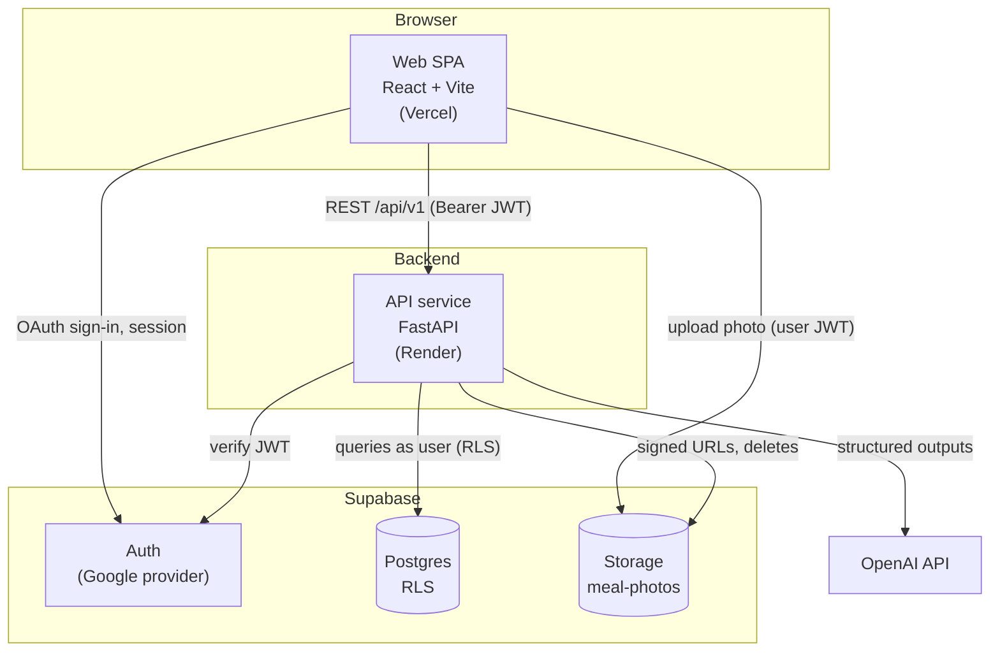
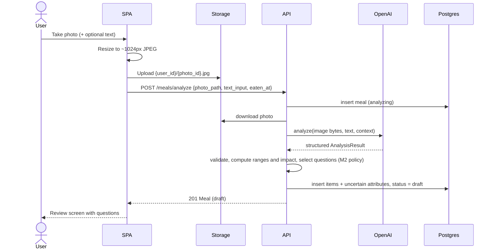
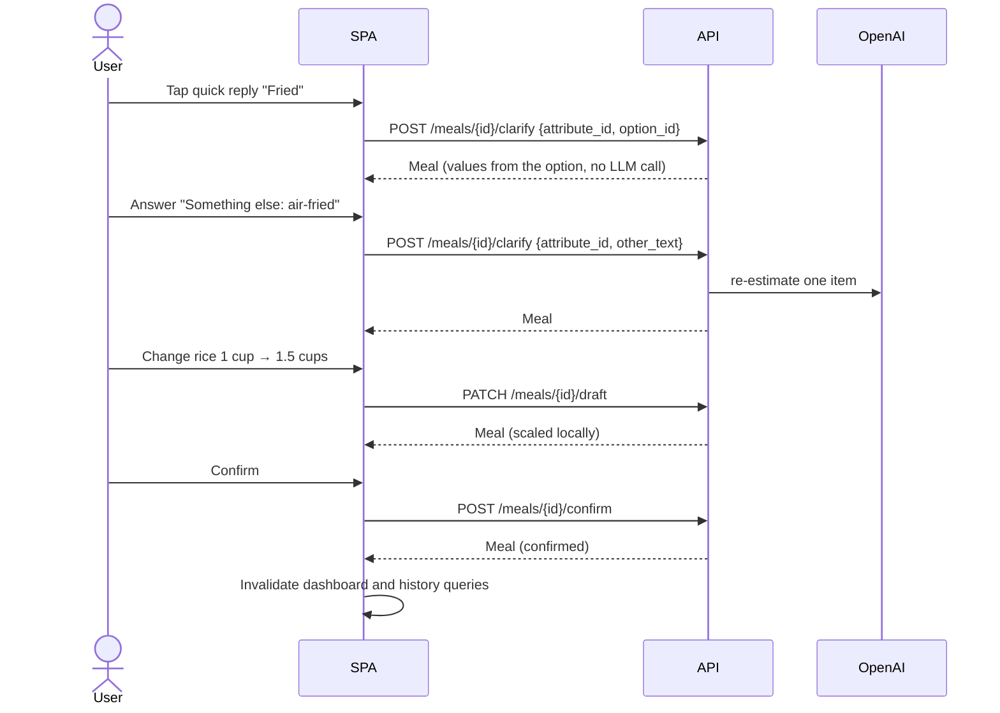

# System Architecture

| | |
|---|---|
| **Status** | Draft |
| **Owner** | Charlie Chiu |
| **Last updated** | 2026-10-21 |
| **Related** | [Tech stack](tech-stack.md), [Data model](../04-data/data-model.md), [API reference](../05-api/api-reference.md) |

## 1. Context



## 2. Containers



| Container | Responsibility | Does **not** |
|---|---|---|
| Web SPA | UI, routing, camera capture, client-side image resize, photo upload, calling the API | Call OpenAI; query Postgres directly |
| API service | Business rules, LLM calls, clarification policy, aggregation, authorization checks | Hold sessions; store files on disk |
| Supabase Auth | Google sign-in, JWT issuance | |
| Postgres | Persistent records, views for totals, RLS | |
| Storage | Meal photos | |

The SPA uses Supabase directly for exactly two things, **sign-in** and **photo upload**. Everything else goes through the API.

## 3. Backend components

```
api/app/
├─ main.py              app factory, middleware, router registration
├─ core/                config, auth (JWT → CurrentUser), errors, Supabase client factory
├─ schemas/             shared Pydantic contracts (Meal, MealItem, Nutrition, Goal, …)
├─ services/
│  └─ llm/              the only module that talks to OpenAI (client, prompts, fixtures)
└─ modules/
   ├─ recognition/      M1  router + service
   ├─ clarification/    M2  router + service + policy
   ├─ meals/            M3  router + repository (meals, goals, profile)
   ├─ analytics/        M4  router + service
   └─ recommendations/  M5  router + service
```

Dependency rules:

- `modules/*` may import `core`, `schemas`, `services`, and another module's **service** (never its router).
- Only `services/llm` imports the OpenAI SDK.
- Only `modules/meals` writes to the `meals`, `meal_items`, `uncertain_attributes`, `profiles`, and `user_goals` tables. Other modules call its repository functions. M1 and M2 may create and update draft rows through those functions.

## 4. Key sequences

### 4.1 Log a meal with a photo



### 4.2 Clarify, edit, and confirm



### 4.3 View history

The SPA calls `GET /analytics/weekly`. The API reads `daily_totals` (a view over confirmed items, joined to effective goals) and returns 7 days, with `null` totals for unlogged days. Selecting a day calls `GET /analytics/daily`; selecting a meal calls `GET /meals/{id}`.

## 5. Cross-cutting concerns

| Concern | Approach |
|---|---|
| Authentication | Supabase JWT in `Authorization: Bearer`; verified by the API with the project's HS256 JWT secret. JWKS (asymmetric signing keys) support is a TODO before deploying to a hosted project. |
| Authorization | RLS on every table; the API uses the caller's JWT for DB access |
| Errors | One error envelope and code list (see [API conventions](../05-api/api-conventions.md)) |
| LLM reliability | Timeout, one retry, schema validation, and semantic checks; on failure the meal is marked `failed` with a reason |
| Observability | Structured JSON logs with request ID, user ID, route, latency, and LLM model and token usage |
| Secrets | Env vars only; never committed; `.env.example` documents each one |
| Development without OpenAI | `LLM_MODE=fixture` returns recorded responses, so every module can be developed offline |

## 6. Deployment

| Environment | Frontend | Backend | Database |
|---|---|---|---|
| Local | `npm run dev` (Vite, :5173) | `uv run fastapi dev` (:8000) | `supabase start` (Docker) or the shared dev project |
| Preview | Vercel preview per PR | Shared dev backend | Shared dev Supabase project |
| Production (demo) | Vercel, `main` branch | Render, `main` branch | Production Supabase project |

Google OAuth redirect URLs must be registered for each environment.
