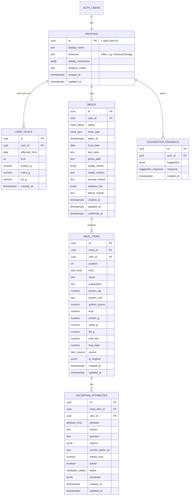

# Data Model

| | |
|---|---|
| **Status** | Draft |
| **Owner** | Yi-Wei Chang |
| **Contributors** | Charlie Chiu |
| **Last updated** | 2026-10-21 |
| **Related** | ADR-0003, ADR-0004, ADR-0005, ADR-0006, [Glossary](../00-overview/glossary.md), [API reference](../05-api/api-reference.md) |

## 1. Overview

All persistent data lives in Supabase: **Postgres** for records and **Storage** for meal photos. Every user-owned row has a `user_id`, and Row Level Security (RLS) restricts it to its owner. The FastAPI backend calls Supabase with the user's JWT, never with the service-role key, except for documented admin tasks.

Design principles:

1. **Store items, derive totals.** Nutrition is stored only on meal items. Meal, daily, and weekly totals are computed from items by views, so edits and deletes propagate automatically.
2. **Keep the AI's first answer.** Each item keeps an immutable snapshot of the original AI prediction, so AI output can be compared with the user's final record.
3. **Overwrite on edit.** Edits to drafts and confirmed meals overwrite current values and bump `updated_at`. There is no version history for meals.
4. **Goals are historical.** Goal changes insert a new row. Past days are always compared with the goal that was in effect on that day.
5. **Absence is not zero.** Days without confirmed meals have no rows, and analytics returns `null` for them, never `0`.

## 2. Entity-relationship diagram



## 3. Enumerations

| Enum | Values | Notes |
|---|---|---|
| `meal_status` | `analyzing`, `draft`, `confirmed`, `failed` | Only `confirmed` meals appear in analytics, suggestions, and chat. |
| `meal_type` | `breakfast`, `lunch`, `dinner`, `snack` | Suggested from `eaten_at` local time; user-editable. |
| `item_kind` | `dish`, `addon` | `addon` = calorie-dense sauce, dressing, oil, or topping listed separately. |
| `item_source` | `ai`, `ai_clarified`, `user_edited`, `user_added` | Current provenance of the item's values. See glossary. |
| `attribute_kind` | `identity`, `portion`, `preparation`, `ingredient` | Which property of an item is uncertain. |
| `resolution_status` | `unresolved`, `answered`, `not_sure` | `not_sure` keeps the attribute flagged; it is not an implicit confirmation. |
| `suggestion_response` | `useful`, `not_for_me`, `already_do` | |

## 4. Tables

### 4.1 `profiles`

One row per user, created on first sign-in by a trigger on `auth.users`.

| Column | Type | Null | Default | Notes |
|---|---|---|---|---|
| `id` | `uuid` | no | | PK; FK → `auth.users.id` `on delete cascade` |
| `display_name` | `text` | yes | from Google profile | |
| `timezone` | `text` | no | `'America/Chicago'` | IANA name; set from the browser on first sign-in |
| `dietary_restrictions` | `text[]` | no | `'{}'` | Free-form tags (e.g. `vegetarian`); used by suggestions |
| `analysis_model` | `text` | yes | `null` | Chosen analysis model; `null` = server default (ADR-0006) |
| `created_at`, `updated_at` | `timestamptz` | no | `now()` | |

### 4.2 `user_goals`

Insert-only history. The **effective goal** for a date `D` is the row with the greatest `effective_from ≤ D`.

| Column | Type | Null | Notes |
|---|---|---|---|
| `id` | `uuid` | no | PK |
| `user_id` | `uuid` | no | FK → `profiles.id` |
| `effective_from` | `date` | no | Local date the goal starts applying |
| `kcal` | `integer` | no | `> 0` |
| `protein_g`, `carbs_g`, `fat_g` | `numeric(6,1)` | no | `≥ 0` |
| `created_at` | `timestamptz` | no | |

- Unique `(user_id, effective_from)`. Changing a goal twice on the same day updates that day's row instead of inserting a new one.
- Days before the first goal have no effective goal. Charts show intake without a goal reference.

### 4.3 `meals`

| Column | Type | Null | Notes |
|---|---|---|---|
| `id` | `uuid` | no | PK |
| `user_id` | `uuid` | no | FK → `profiles.id` |
| `status` | `meal_status` | no | |
| `meal_type` | `meal_type` | no | |
| `eaten_at` | `timestamptz` | no | Defaults to capture time; user may choose a past time (backfill) |
| `local_date` | `date` | no | `eaten_at` converted to `profiles.timezone` at write time. Not recomputed if the user later changes time zone. |
| `text_input` | `text` | yes | User's optional description |
| `photo_path` | `text` | yes | Storage object path; `null` for text-only meals or after photo deletion |
| `image_issues` | `text[]` | no | Default `'{}'`. Non-blocking photo problems from analysis: `blurry`, `dark`, `partial`, `multiple_meals`, `obstructed` |
| `model_version`, `prompt_version` | `text` | yes | Recorded at analysis (ADR-0003) |
| `analysis_raw` | `jsonb` | yes | Raw validated LLM response, kept for debugging and evaluation |
| `failure_reason` | `text` | yes | Set when `status = failed` |
| `created_at`, `updated_at` | `timestamptz` | no | |
| `confirmed_at` | `timestamptz` | yes | First confirmation time |

Indexes: `(user_id, local_date)`, `(user_id, status)`.

### 4.4 `meal_items`

Nutrition values are stored **unrounded** for the item's current portion. Rounding happens only in the UI. A portion-only change scales every nutrition value, plus `kcal_low` and `kcal_high`, by `new_grams / old_grams`.

| Column | Type | Null | Notes |
|---|---|---|---|
| `id` | `uuid` | no | PK |
| `meal_id` | `uuid` | no | FK → `meals.id` `on delete cascade` |
| `user_id` | `uuid` | no | Denormalized for simple RLS |
| `position` | `smallint` | no | Display order |
| `kind` | `item_kind` | no | |
| `name` | `text` | no | User-facing name, e.g. "Chicken burrito" |
| `preparation` | `text` | yes | e.g. `grilled`, `fried` |
| `portion_qty` | `numeric` | no | e.g. `1.5` |
| `portion_unit` | `text` | no | Familiar unit: `cup`, `piece`, `slice`, `tbsp`, `g` |
| `portion_grams` | `numeric` | no | Estimated weight |
| `kcal`, `protein_g`, `carbs_g`, `fat_g` | `numeric` | no | Current estimate |
| `kcal_low`, `kcal_high` | `numeric` | yes | Estimate range from the unresolved options; `null` when there is no meaningful spread |
| `source` | `item_source` | no | |
| `ai_original` | `jsonb` | yes | Immutable snapshot of the AI's original item. `null` for `user_added`. |
| `created_at`, `updated_at` | `timestamptz` | no | |

### 4.5 `uncertain_attributes`

One row per uncertain attribute reported by the analysis. The clarification policy (M2) selects which rows to ask about (`asked = true`). Rows that are not asked still drive review cues on the review screen (ADR-0004).

| Column | Type | Null | Notes |
|---|---|---|---|
| `id` | `uuid` | no | PK |
| `meal_item_id` | `uuid` | no | FK → `meal_items.id` `on delete cascade` |
| `user_id` | `uuid` | no | Denormalized for RLS |
| `attribute` | `attribute_kind` | no | |
| `reason` | `text` | no | Plain-language reason shown in the review cue |
| `question` | `text` | no | Generated for every attribute; shown only if `asked` |
| `options` | `jsonb` | no | See §5.1 |
| `current_option_id` | `text` | no | Option currently reflected in the item's values |
| `impact_kcal` | `numeric` | no | Max − min kcal across options; used for ranking |
| `asked` | `boolean` | no | Set by the clarification policy |
| `status` | `resolution_status` | no | Default `unresolved` |
| `resolution` | `jsonb` | yes | Chosen option or free-text answer |
| `created_at`, `updated_at` | `timestamptz` | no | |

### 4.6 `suggestion_feedback`

| Column | Type | Null | Notes |
|---|---|---|---|
| `id` | `uuid` | no | PK |
| `user_id` | `uuid` | no | |
| `suggestion` | `jsonb` | no | Snapshot of the suggestion shown (text, pattern, evidence) |
| `response` | `suggestion_response` | no | |
| `created_at` | `timestamptz` | no | |

Suggestions themselves are generated on request and not stored. Chat storage is undecided (see Open questions).

## 5. JSON shapes

### 5.1 `uncertain_attributes.options`

```json
[
  {
    "id": "grilled",
    "label": "Grilled",
    "nutrition": { "kcal": 250, "protein_g": 46, "carbs_g": 0, "fat_g": 6 },
    "portion": null
  },
  {
    "id": "fried",
    "label": "Fried",
    "nutrition": { "kcal": 390, "protein_g": 42, "carbs_g": 12, "fat_g": 19 },
    "portion": null
  }
]
```

- `nutrition` holds the item's full estimate if this option is chosen, at the item's current portion.
- For `attribute = portion`, each option carries `portion: { "qty", "unit", "grams" }`.
- "Not sure" and "Something else" are UI affordances and are not stored as options.

### 5.2 `meal_items.ai_original`

The validated item exactly as returned by the analysis, before any clarification or edit. Its schema matches the M1 analysis response item (defined in `03-design/m1-meal-recognition.md`).

## 6. Derived views

| View | Grain | Definition |
|---|---|---|
| `meal_totals` | meal | Sum of item nutrition, `kcal_low`, and `kcal_high` (an item with no range contributes its `kcal` to both bounds) for every meal |
| `daily_totals` | user × `local_date` | Sum over **confirmed** meals; `meal_count`; joined to the effective goal. Only dates with ≥ 1 confirmed meal produce rows. |

Weekly and longer aggregations are computed from `daily_totals` by the analytics endpoints. Averages divide by the number of **logged days**, not by 7 (ADR-0005).

All views use `security_invoker = true`, so RLS on the base tables applies.

## 7. Photo storage

| | |
|---|---|
| Bucket | `meal-photos` (private) |
| Path | `{user_id}/{photo_id}.jpg` (`photo_id` is a UUID generated by the client, because the photo is uploaded before the meal exists) |
| Upload | Directly from the SPA after client-side resize (longest edge ≈ 1024 px, JPEG) |
| Read | Short-lived signed URLs issued by the backend for the SPA; the backend downloads the bytes itself for the LLM call |
| Policy | Storage RLS: the first path segment must equal `auth.uid()` |
| Delete photo only | Remove the object and set `meals.photo_path = null`; nutrition records remain |

## 8. Access control (RLS)

Every table has RLS enabled, with policies for `select`, `insert`, `update`, and `delete` using `user_id = auth.uid()` (`id = auth.uid()` for `profiles`). `user_goals` additionally disallows `update` and `delete` from the client, except for same-day replacement handled by the backend.

## 9. Lifecycle and integrity rules

| Event | Effect |
|---|---|
| Analyze | Insert `meals` (`analyzing`) → on success insert `meal_items` and `uncertain_attributes`, set `draft`; on error set `failed` with `failure_reason` |
| Answer clarification | Update the attribute's `status`, `resolution`, and `current_option_id`; copy the chosen option's values into the item; set item `source = ai_clarified` |
| Edit item | Overwrite values; set `source = user_edited`; bump `updated_at` |
| Confirm | `status = confirmed`; set `confirmed_at` if null |
| Edit confirmed meal | Overwrite in place (the meal stays confirmed); views reflect the change immediately |
| Delete meal | Hard delete; items and attributes cascade; backend deletes the photo object |
| Delete account | Cascade from `auth.users`; backend purges the user's storage folder |
| Abandoned drafts | Drafts older than 7 days may be purged by a scheduled job (to be decided) |

## 10. Migrations

- Manage schema with the Supabase CLI in `supabase/migrations/`, one timestamped SQL file per change.
- Never edit a migration that has been merged; add a new one.
- Seed data for local development and demos lives in `supabase/seed.sql`.

## 11. Open questions

| # | Question | Owner |
|---|---|---|
| D1 | Should chat conversations be persisted? If so, which tables? | Zach |
| D2 | Should abandoned drafts be purged automatically, and after how long? | Yi-Wei |
| D3 | Should `local_date` be recomputed if a user changes time zone? (Current answer: no.) | Yi-Wei |
| D4 | Is the `(user_id, effective_from)` same-day replacement rule sufficient for goal edits? | Yi-Wei |
