# User Manual

| | |
|---|---|
| **Status** | Current as of Nov 19, 2026 |
| **Applies to** | `main` after PR #8 (D3 visualizations) |
| **Screens** | Phone, 375 px wide, light mode |

Meal Logging turns a photo or a short description of a meal into an editable nutrition record. The app asks only the few questions that change the estimate most. It then shows how your days and weeks compare with your goals, and which numbers you have checked versus which are still AI estimates.

All calories and macros in the app are **estimates**.

## Contents

1. [Getting around](#1-getting-around)
2. [Log a meal](#2-log-a-meal)
3. [Review and confirm a meal](#3-review-and-confirm-a-meal)
4. [Today](#4-today)
5. [Week](#5-week)
6. [History and the calendar heatmap](#6-history-and-the-calendar-heatmap)
7. [Meal details](#7-meal-details)
8. [Suggestions](#8-suggestions)
9. [Chat](#9-chat)
10. [Settings and goals](#10-settings-and-goals)
11. [How to read the charts](#11-how-to-read-the-charts)
12. [Good to know](#12-good-to-know)

---

## 1. Getting around

The bottom bar has five items:

| Item | What it opens |
|---|---|
| **Today** | Calories and macros for one day, and that day's meals |
| **History** | A 4-week calendar heatmap and a list of past meals |
| **Log** (center camera button) | Log a new meal |
| **Suggestions** | Meal ideas based on patterns in your logged days, and Chat |
| **Settings** | Goals, analysis model, time zone |

Sign in with your Google account the first time you open the app.

## 2. Log a meal

<table><tr>
<td>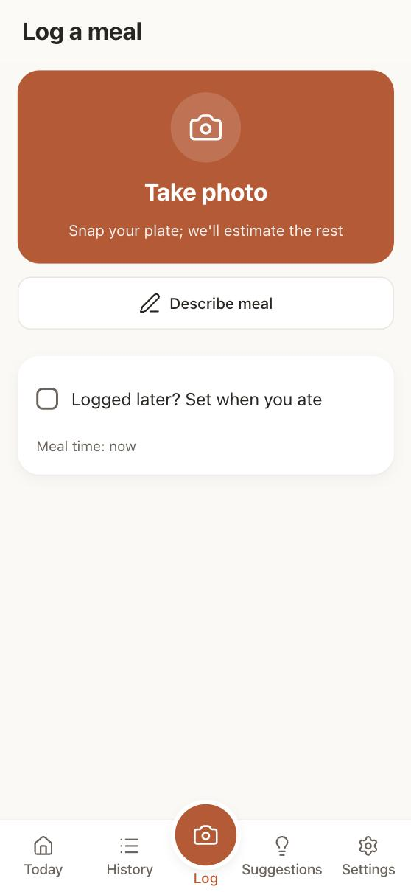</td>
<td>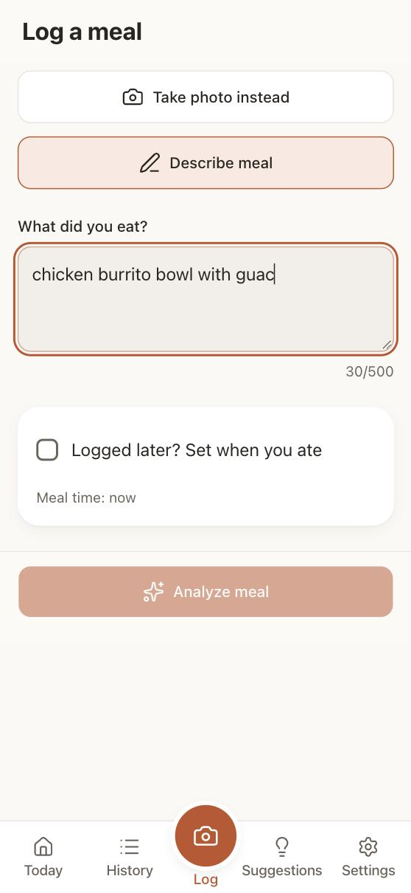</td>
<td>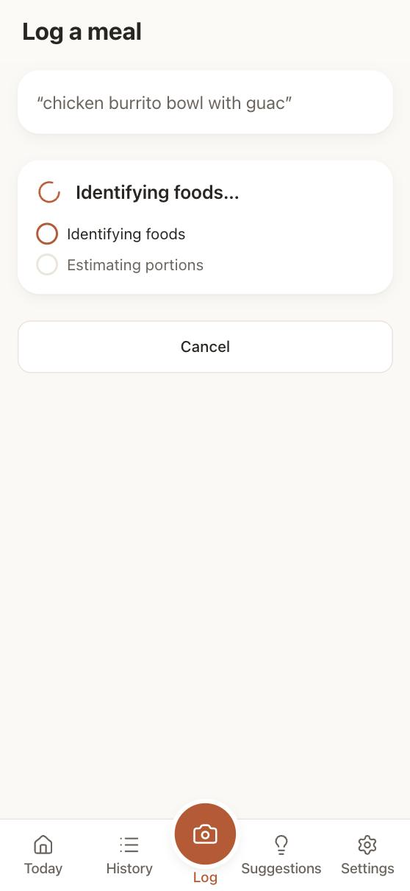</td>
</tr></table>

1. Tap **Log** in the bottom bar.
2. Choose one:
   - **Take photo**: opens the camera. Take one photo of the whole plate in good light. You can add a short note, such as "extra rice".
   - **Describe meal**: type what you ate, for example *chicken burrito bowl with guac*.
3. Ate earlier? Tick **Logged later? Set when you ate** and pick the date and time.
4. Tap **Analyze meal**. The app identifies the foods and estimates portions. This usually takes a few seconds. Tap **Cancel** to stop.

If the analysis fails, you can **Retry** or **Describe instead**.

## 3. Review and confirm a meal

After the analysis, you see a draft of the meal. Nothing is saved to your history until you confirm it.

<table><tr>
<td>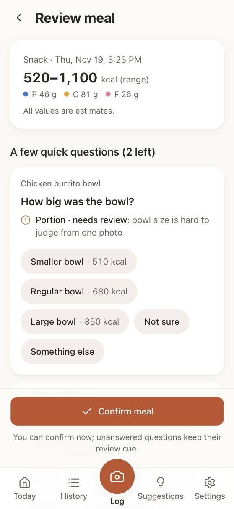</td>
<td>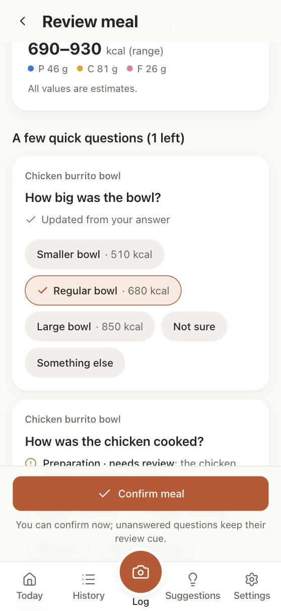</td>
</tr></table>

**The calorie range.** If the AI is unsure about something, the total is shown as a range, for example **520–1,100 kcal**.

**Quick questions.** The app asks at most two questions, picked by how much they could change the calories. Each answer shows its calories, such as *Regular bowl · 680 kcal*, so you can see why the question matters.

- Tap an answer and the range narrows right away. In the example above, it goes from 520–1,100 to **690–930 kcal**. The question then shows *Updated from your answer*.
- **Not sure** leaves the item marked for review. It does not count as confirmed.
- **Something else** lets you type the correct answer; the app re-estimates that item.

<table><tr>
<td>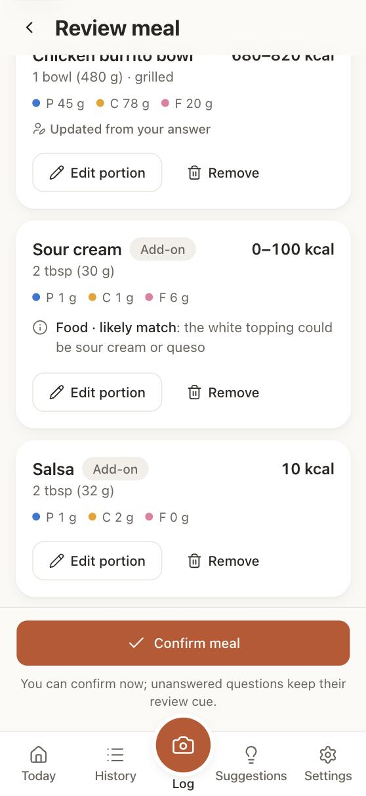</td>
<td>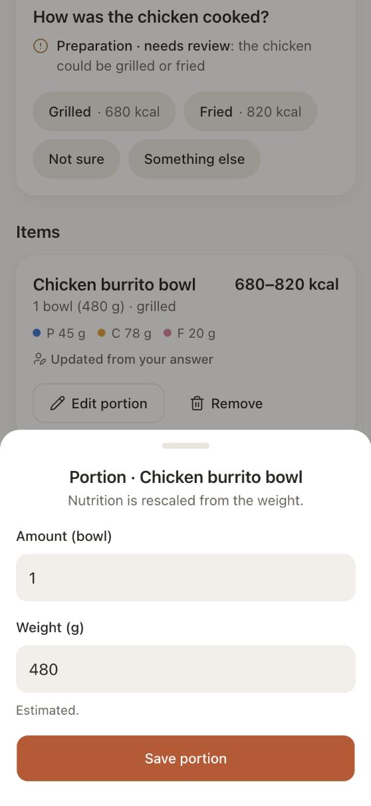</td>
</tr></table>

**Items.** Scroll down to see every food:

- Each item shows its portion in a familiar unit and in grams, for example *1 bowl (480 g)*, plus its calories and macros.
- **Add-on** marks calorie-dense extras such as sauces, dressings, and toppings. They are listed separately so you can check them.
- **Review cues** explain what the AI was unsure about, for example *Food · likely match: the white topping could be sour cream or queso*. The app never shows a confidence percentage.
- **Edit portion** opens a sheet where you change the amount or the weight. Nutrition is rescaled from the weight.
- **Remove** deletes an item from the draft.

Tap **Confirm meal** when it looks right. You can confirm with questions still open; they keep their review cue.

## 4. Today

<table><tr>
<td>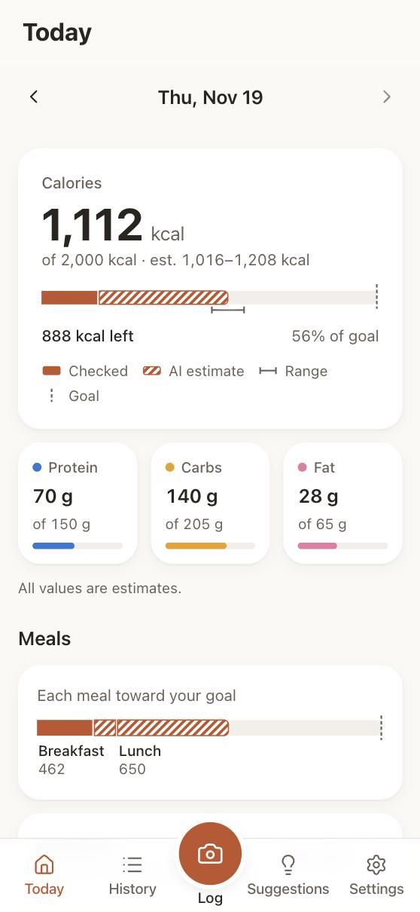</td>
<td>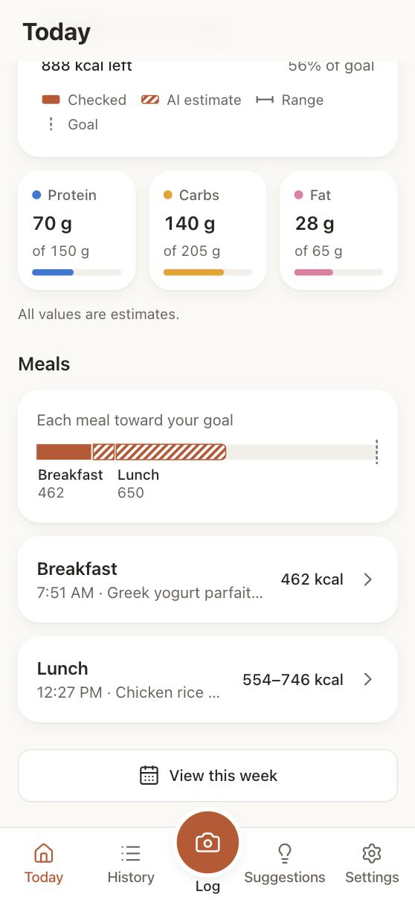</td>
</tr></table>

- **Calories card.** Shows calories eaten, your goal, the estimated range, and how much is left, or a neutral "N kcal over goal" once you pass it. The bar shows **checked** calories (solid) and **AI estimates** (striped), with the range whisker underneath and the goal as a dashed tick. See [§11](#11-how-to-read-the-charts).
- **Protein, Carbs, Fat.** Grams eaten against each goal.
- **Each meal toward your goal.** One bar split into today's meals. Tap a meal to open it.
- **Meals list.** Tap a meal to open its details. **View this week** opens the Week view.
- Use the **‹ ›** arrows at the top to move between days.

## 5. Week

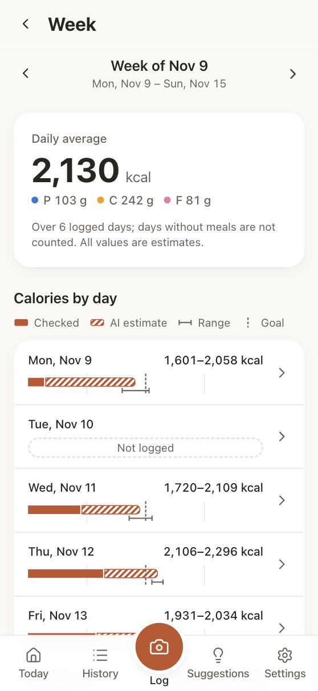

- **Daily average** counts only days you logged. The card says how many, for example *Over 6 logged days*.
- **Calories by day.** One row per day, all on the same scale:
  - Solid = calories you checked; striped = AI estimates; whisker = range; dashed tick = that day's goal.
  - **Not logged** (dashed outline) means no meals were recorded. It is shown as unknown, never as zero.
  - **Upcoming** marks future days.
- Tap a day to open it in Today. Use **‹ ›** to change weeks. Past weeks are titled "Week of …".

## 6. History and the calendar heatmap

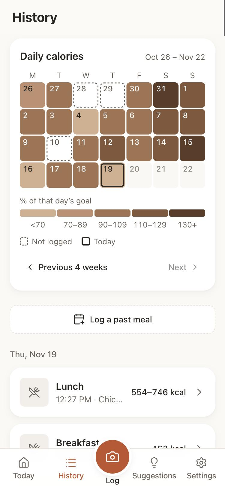

The **Daily calories** calendar shows four weeks at a glance:

- Columns are weekdays (Mon–Sun) and rows are weeks, so patterns such as "more on weekends" line up vertically.
- Color shows calories as a **% of that day's goal**, in five shades of one warm color: <70, 70–89, 90–109, 110–129, 130+. Darker means more. No color means "good" or "bad".
- **Dashed cells** are days with no meals logged (unknown, not zero).
- **Today** has a ring around it, because the day is still in progress. Future days are faint.
- Tap a day to open it in Today. **Previous 4 weeks** and **Next** move through time.

Below the calendar:

- **Log a past meal** adds a meal on an earlier date.
- The **meal list** shows your meals by date, newest first. Tap a meal to open it.

## 7. Meal details

<table><tr>
<td>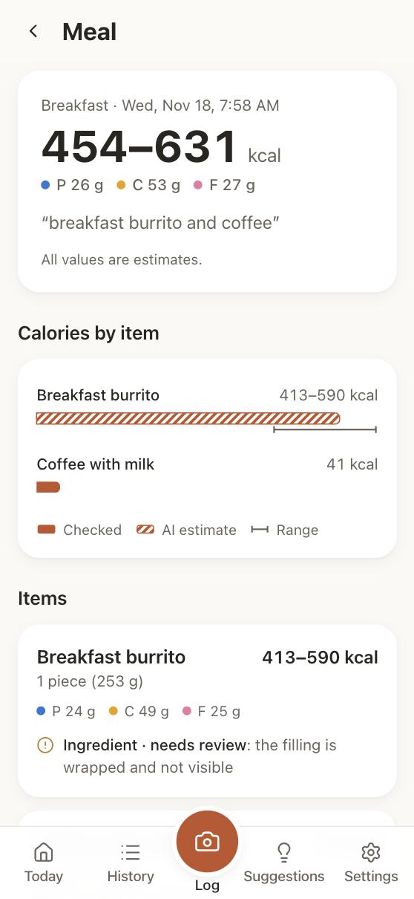</td>
<td>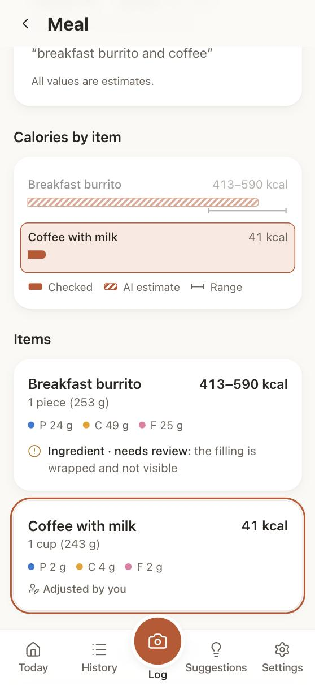</td>
<td>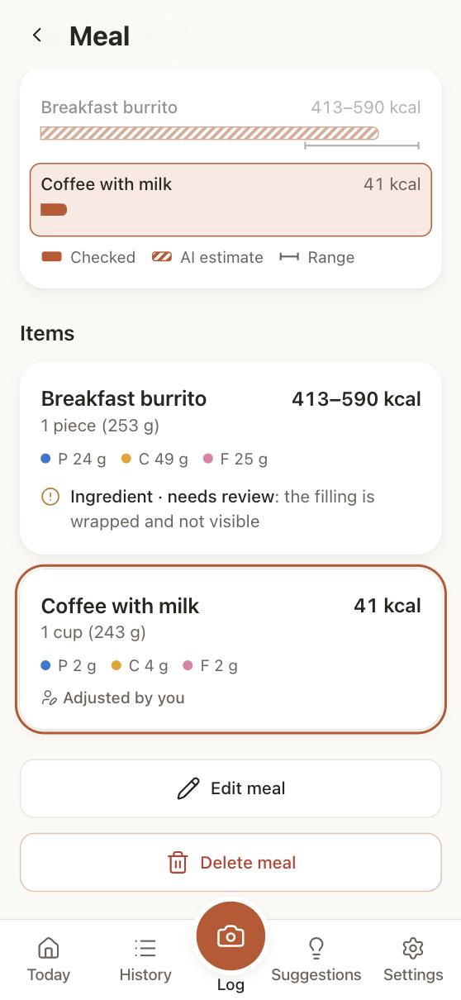</td>
</tr></table>

- The top card shows the meal's total (a range if anything is still uncertain), its macros, and the text you entered.
- **Calories by item** sorts the foods from most to least calories. Solid bars were checked by you; striped bars are AI estimates; whiskers show ranges.
- **Tap a bar** to highlight that food in the **Items** list below. Tap an item card to highlight its bar. Tap again to clear.
- Items carry labels for where their values came from:
  - **Adjusted by you**: you edited it.
  - **Updated from your answer**: you answered a question about it.
  - No label: an AI estimate.
- **Edit meal** reopens the review screen. **Delete meal** removes the meal after a confirmation; you can also delete only the photo.

Every chart updates as soon as you edit or delete a meal.

## 8. Suggestions

<table><tr>
<td>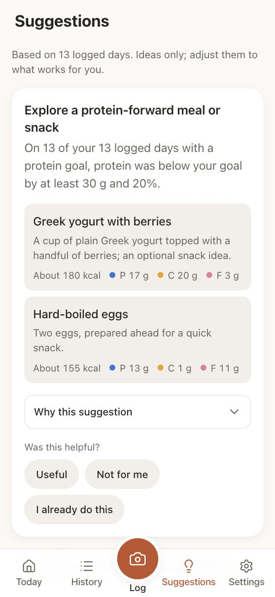</td>
<td>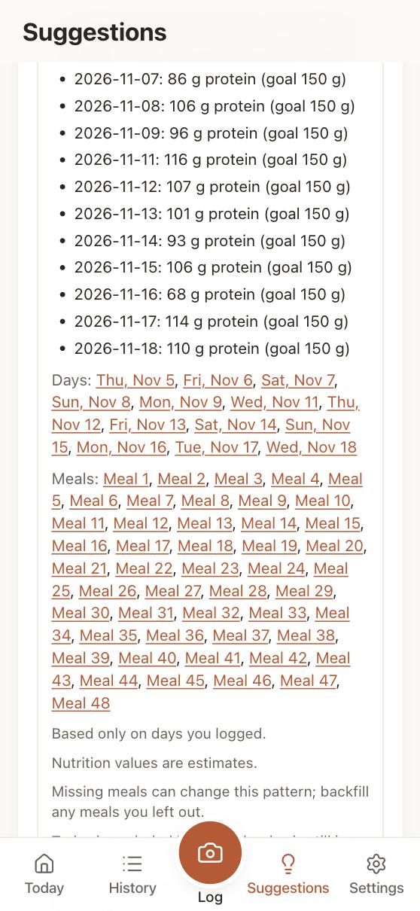</td>
</tr></table>

Suggestions look for one clear pattern in your last 14 logged days (today is excluded) and offer two meal or snack ideas with estimated calories and macros.

- **Why this suggestion** lists the days and values behind the pattern, with links to those days and meals.
- Suggestions need at least **3 logged days**. They are based only on days you logged, so missing meals can change them.
- Tell the app what you think: **Useful**, **Not for me**, or **I already do this**. "Not for me" and "I already do this" hide that topic for 7 days.

Ideas are suggestions only. They never add meals to your history.

## 9. Chat

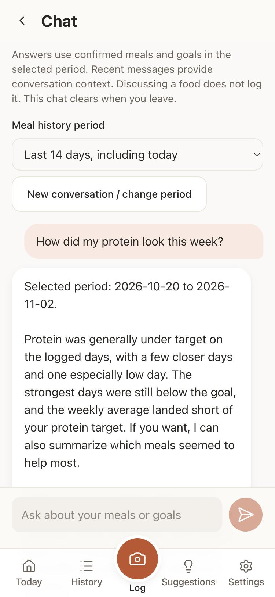

Open **Ask about your meals** from the Suggestions page to ask questions such as *How did my protein look this week?* or *Would a burrito bowl fit my goals tonight?*

- Choose the **Meal history period** the answers should use.
- Answers use only your **confirmed** meals and goals. Foods you discuss are not logged.
- The conversation clears when you leave the page. **New conversation / change period** starts over.

## 10. Settings and goals

<table><tr>
<td>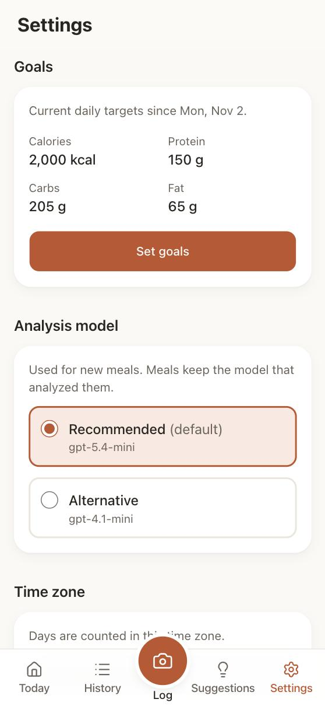</td>
<td>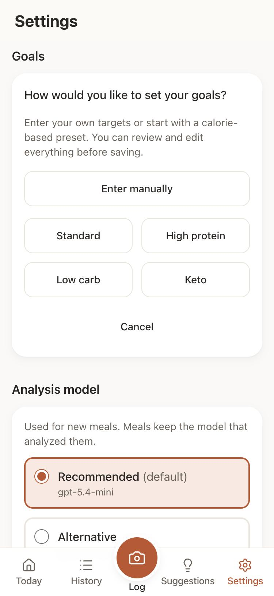</td>
</tr></table>

**Goals.** Shows your current daily targets and when they started. Tap **Set goals** to:

- **Enter manually**, or
- start from a preset: **Standard**, **High protein**, **Low carb**, or **Keto**. Presets convert a calorie target into grams, and you can edit every value.
- Optionally estimate a calorie target from age, height, weight, and activity. These measurements are not saved.

Nothing is saved until you tap **Save goal**. Goals are kept as history, so past days are always compared with the goal you had on that day.

**Analysis model.** Chooses the AI model used for new meals. Meals you already logged keep the model that analyzed them.

**Time zone.** Days are counted in this time zone.

## 11. How to read the charts

| Mark | Meaning |
|---|---|
| Solid bar | Calories you **checked**: you answered a question, edited, or added the item |
| Striped bar | Calories that are **AI estimates** you have not touched |
| Whisker under a bar (├──┤) | The estimated **range** while something is still uncertain |
| Dashed gray tick | The **goal** for that day (a reference, not a limit) |
| Dashed empty slot or cell | **Not logged**: no meals recorded; unknown, not zero |
| "Upcoming" / faint cell | A future day |
| Ring around a heatmap cell | Today (still in progress) |
| Heatmap shades | % of that day's calorie goal: <70, 70–89, 90–109, 110–129, 130+ |
| Blue / yellow / pink dot | Protein / carbs / fat (always with a text label) |

Going over a goal is shown with neutral text, such as "120 kcal over goal". The app never colors a day or a food as "good" or "bad".

## 12. Good to know

- **Estimates.** Photos cannot show hidden oil, sauces, or exact portions. Answering the quick questions and checking portions makes the numbers more reliable, and the charts show how much of each total you have checked.
- **Missing days.** If you skip logging a day, it shows as *Not logged* and is left out of averages and suggestions. Use **Log a past meal** to fill gaps.
- **Editing.** Changes to a meal update Today, Week, History, and Suggestions immediately.
- **Privacy.** Your meals, photos, and goals are visible only to your account. You can delete any meal or photo.
